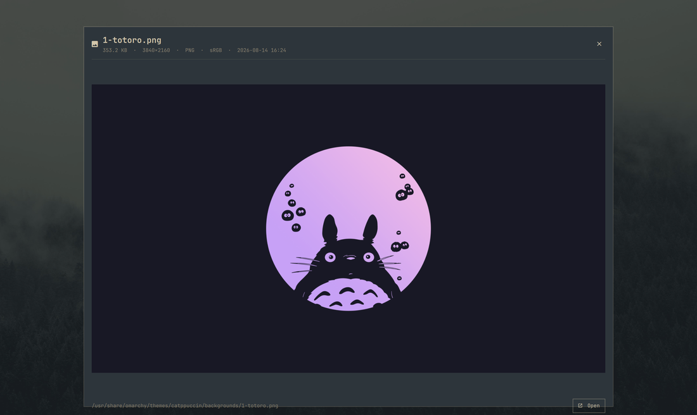

# QuickArchy

Anteprima file in stile macOS per Omarchy. Selezioni un file in Files, premi **Space**, e lo vedi: disegnato, non descritto. Premi Space di nuovo per chiudere.

Fork personale (`sairons.quickarchy`) di [andreconde21/omarchy-quick-look](https://github.com/andreconde21/omarchy-quick-look), con la stampa e tre correzioni descritte in fondo.



## Cosa mostra

| Tipo | Cosa vedi |
|---|---|
| Immagini | l'immagine, adattata allo schermo, con dimensioni e formato |
| PDF | le pagine vere, renderizzate (le prime 8), con numero di pagine e peso |
| Video | un fotogramma, durata, risoluzione e codec |
| Audio | la copertina incorporata, titolo/artista/album, durata |
| Testo e codice | il contenuto, fino a 400 righe |
| Markdown | il sorgente, mostrato letteralmente (vedi Note) |
| Cartelle | il contenuto, prima le sottocartelle |
| Archivi | l'elenco delle voci |
| Tutto il resto | tipo, peso e cosa ne dice `file` |

## I tasti

| Tasto | Azione |
|---|---|
| **Space** su un file selezionato in Files | apre l'anteprima |
| **Space**, **Esc** o **Q** | chiude l'anteprima |
| **Enter** | apre il file nel programma predefinito |
| **P** o **Ctrl+P** | stampa |

## Come si apre

Nautilus non permette alle estensioni di legare tasti. Quello che fa è attivare via D-Bus il nome noto `org.gnome.NautilusPreviewer` quando premi Space su una selezione. Questo plugin fornisce un piccolo *ponte* che risponde a quel nome e gira la richiesta alla propria scheda: è il modo supportato per mettere la propria anteprima dietro il tasto Space.

Le vie d'ingresso:

- **Space** su un file selezionato in Files
- **Tasto destro → QuickArchy** (estensione di Nautilus, per farsi trovare)
- `omarchy-shell sairons.quickarchy show /percorso/file`

## La stampa

Premi **P** (o Ctrl+P) dentro l'anteprima e il file va alla **stampante predefinita di CUPS**. Le immagini vengono adattate alla pagina (`fit-to-page`), i PDF inviati così come sono, il testo semplice convertito dalla catena di filtri di CUPS. Tutto il resto — cartelle, archivi, video, audio, binari — viene **rifiutato prima** di accodare il lavoro, perché un lavoro che esce in bianco consuma solo carta.

La scheda riporta cosa ha risposto CUPS: `Sent to <stampante>` se è andata, oppure il motivo del rifiuto. La riga si cancella da sola dopo qualche secondo.

- Quale stampante: quella predefinita di sistema. Si cambia con `lpoptions -d <nome>`, si elencano con `lpstat -p`.
- Stampare su una stampante specifica senza toccare la predefinita: `bin/quick-look-print <file> --printer <nome>`
- Da un tasto o da uno script: `omarchy-shell sairons.quickarchy printFile /percorso/file` (l'ultimo esito si legge con `printResult`).

## Requisiti

- Omarchy 4 / Quattro con supporto ai plugin di Quickshell
- `python3` con PyGObject (`python-gobject`) — serve al ponte per il tasto Space
- `file` — obbligatorio; senza, niente viene classificato e ogni file finisce su "nessuna anteprima"
- `imagemagick` — **obbligatorio per le immagini**: misura un'immagine prima di decodificarla, quindi senza di lui le immagini vengono rifiutate anziché mostrate
- `poppler` (pagine dei PDF), `ffmpeg` e `ffmpegthumbnailer` (fotogrammi e copertine), `bsdtar`/libarchive (elenco degli archivi) — opzionali, ognuno incide solo sul proprio tipo di file
- `xdg-open` per il pulsante Open, `nautilus-python` per la voce del tasto destro — entrambi opzionali
- `cups` (`lp`, `lpstat`) con una stampante predefinita configurata — necessario per la stampa; senza, il pulsante Print resta visibile e la scheda segnala che non c'è una stampante predefinita

## Installazione

Si installa dal clone locale:

```bash
omarchy plugin add /home/sairons/Work/omarchy-quick-look --enable --yes
```

Poi registra il ponte per il tasto Space:

```bash
mkdir -p ~/.local/share/dbus-1/services
cat > ~/.local/share/dbus-1/services/org.gnome.NautilusPreviewer.service <<EOF
[D-BUS Service]
Name=org.gnome.NautilusPreviewer
Exec=$HOME/.config/omarchy/plugins/sairons.quickarchy/bin/quick-look-previewer
EOF
nautilus -q
dbus-send --session --dest=org.freedesktop.DBus --type=method_call /org/freedesktop/DBus org.freedesktop.DBus.ReloadConfig
```

L'ultima riga serve al primo giro: il bus di sessione legge l'elenco dei servizi **al proprio avvio**, quindi senza il ricaricamento continuerebbe a rispondere l'anteprima di sistema (sushi) e non questo plugin.

Volendo anche la voce nel menu del tasto destro:

```bash
mkdir -p ~/.local/share/nautilus-python/extensions
cp ~/.config/omarchy/plugins/sairons.quickarchy/nautilus/quick_look.py \
   ~/.local/share/nautilus-python/extensions/
nautilus -q
```

## Note

- Le anteprime sono renderizzate come testo semplice, Markdown compreso. Un'anteprima mostra file che questa shell non ha scritto, e i formati di testo ricco di Qt risolvono da soli i riferimenti a immagini e HTML dentro un processo di lunga durata; il testo semplice non può riferirsi a risorse esterne. È uno scambio voluto: formattazione in cambio di una proprietà garantita per costruzione.
- Pagine renderizzate, fotogrammi e copertine sono in cache sotto `~/.cache/omarchy/quick-look`, indicizzati per percorso e data di modifica, e rimossi dopo 7 giorni. Riaprire un file è istantaneo; se cambia, si rigenera.
- I video si vedono come fotogramma singolo, non si riproducono. Premi Enter per aprirli in un lettore vero.
- Tutta la gestione dei formati vive in `bin/quick-look-probe`, che stampa JSON: lancialo su un file per vedere esattamente cosa disegnerà la scheda.

## Se Space non risponde

Un processo del ponte rimasto appeso (o l'anteprima di sistema, sushi) può tenere occupato il nome D-Bus. Si controlla così:

```bash
pgrep -af quick-look-previewer     # il ponte del plugin
pgrep -x sushi                     # l'anteprima di GNOME
pkill -f quick-look-previewer      # libera il nome; la prossima pressione lo riavvia
```

## Le differenze dall'originale

1. **Stampa** — `P` / `Ctrl+P` e il pulsante nella scheda: nell'originale non esisteva. Il lavoro passa da `bin/quick-look-print`, che rifiuta i tipi non stampabili prima di accodare.
2. **Il plugin trova i propri script** — l'originale si fidava di `manifest.__sourceDir`, un campo che la shell **cancella** dai manifest dei plugin di terze parti: ogni anteprima falliva con "Preview helper not found". Ora il percorso si ricava dall'identificativo pubblico del plugin (`$XDG_CONFIG_HOME/omarchy/plugins/<id>`), con `__sourceDir` come prima scelta quando il campo c'è.
3. **Il piè di pagina sta dentro la scheda** — l'altezza dell'area dell'immagine veniva calcolata sottraendo `footer.implicitHeight`, che è 0 perché il piè di pagina ha un'altezza esplicita: il corpo restava 28 px troppo alto e il piè di pagina (nome file + Print/Open) finiva oltre il bordo inferiore. Ora si sottraggono le altezze reali.
4. **Nome** — identificativo `sairons.quickarchy`, nome visibile "QuickArchy", namespace del layer Wayland e voce del menu di Nautilus allineati.
5. **Documentazione** — questo README in italiano.

## Disinstallazione

```bash
omarchy plugin remove sairons.quickarchy --yes
```

Per ridare il tasto Space all'anteprima di GNOME (sushi) e buttare la cache dei render:

```bash
rm -f ~/.local/share/dbus-1/services/org.gnome.NautilusPreviewer.service
rm -f ~/.local/share/nautilus-python/extensions/quick_look.py
rm -rf ~/.cache/omarchy/quick-look
nautilus -q
dbus-send --session --dest=org.freedesktop.DBus --type=method_call /org/freedesktop/DBus org.freedesktop.DBus.ReloadConfig
```

## Licenza

MIT — vedi [LICENSE](LICENSE).
